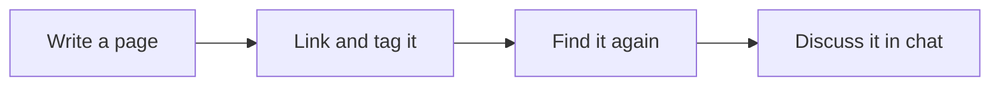

# Welcome to %APP_TITLE%

This is the start page of this Space. It is an ordinary page, so make it your own: press **e** (or the pencil icon) to edit it, replace this tour with an overview of what the Space is for, or delete it.

{toc maxLevels:2}

## Get started

- **Spaces** keep separate areas of the wiki apart. Each has its own pages, tags and settings. Switch between them with the selector at the bottom of the sidebar.
- **New** creates a Markdown page, a folder, a draw.io diagram, a list (a small spreadsheet with typed columns), a chat, a JSON data page, a saved search, or a files library.
- **Templates.** New pages can start from a template. The `templates` folder in this Space holds them, and you can edit them or add your own.
- **Organise** pages by dragging them between folders, or use copy, move and rename. You can import Markdown files by dropping them from your computer onto the page tree.
- **Tabs.** Pages open in tabs above the page. **Alt+1** to **Alt+9** switch tabs, **Alt+W** closes one, and **Ctrl+Alt+←/→** steps through them.
- **Links that last.** Every page has a stable ID, so a link to it keeps working after the page is renamed or moved. Use **Share** to copy a link or email it to someone.

## Writing pages

Pages are written in Markdown. In the editor press **Alt+A** to see editor hotkeys. You can switch between **Inline** mode, where one paragraph is edited at a time, and **Classic** mode, where all the Markdown is shown. Beyond plain Markdown, pages can use:

- **Wikilinks.** Put a page name in double square brackets to link to it, add a heading after a `#` to link to a section, or put an exclamation mark in front to embed the page, or just one of its sections, inline. Renaming a page offers to update the wikilinks that point at it.
- **Images and attachments.** Paste a screenshot straight into the editor, or attach files to a page.
- **Callouts**, like the tip above. Start a quote with `> [!note]`, `> [!tip]`, `> [!warning]` or one of the other callout types.
- **Diagrams as text.** A fenced `mermaid` code block renders as a diagram. *Insert → Mermaid Diagram* has starters:

- **A table of contents.** Type the word toc in curly braces and it is generated from the page's headings. This page has one at the top.
- **Tags**, added in the page footer, appear in the tag cloud under Search.
- **Page metadata.** If this Space has it turned on, YAML front matter at the top of a page is shown in the page header and can be edited there.

## Finding things

- **Search** covers the full text of every page. The tag cloud shows tags from every Space you can read.
- **Advanced search** (content type) builds a query you save as a page, so you can run it again whenever you want.
- **The knowledge graph** shows how pages connect through links, folders and shared tags. **Backlinks** list the pages that link to the one you are reading.
- **Version history** (when the wiki keeps its content in git) shows a page's earlier versions and can restore them.

## Working together

- **Chats** are pages too. Reply to a message, react to it, pin it, copy it or save it as a page. **Page chat** puts a conversation beside any page.
- **@mention** someone to notify them. **My Mentions** in the sidebar collects every mention of you, with a badge counting the new ones.
- **Select text** on a page to quote it in chat, search for it, start a new page from it, or ask an AI about it.
- **Changes appear live.** If someone edits the page you have open, it reloads. If you are editing it yourself, you get a warning instead, and your unsaved work is left alone.
- **My Preferences** has the language (nine are available), fonts, and an optional daily digest email of changed pages and new mentions.

## AI assistants

If an administrator has set up AI users, they work alongside you:

- You can specify custom instructions for each and create virtual team members, e.g. "#botCompliance" or "#botPO".
- **Mention one with #**, for example `#Assistant summarise this page`, in a chat or a page chat. It can read, search, create and update pages in the Spaces it has access to.
- **Chat commands:** `/aiJob #Assistant …` queues a longer, more thorough task that runs in the background and posts its answer when it is done. `/jobs` lists your background jobs, `/aiUsers` lists the assistants, and `/summarize` summarises the conversation. Type `/` in a chat to see the rest.
- **Explain** in the selection toolbar asks an AI about the text you selected.
- **AI memory.** If it is turned on for this Space, an assistant can keep notes on what it learns, as ordinary pages you can read and correct.
- **Other tools can connect** to the wiki over MCP (Model Context Protocol), for example Claude Desktop or your own agents.
- You can add MCP servers and choose which of them each AI user can use.

## For administrators

- **Space settings** (the gear beside the Space selector) can make a Space read-only, turn page metadata and AI memory on or off, or merge the Space into another.
- **The Admin panel** manages users and access requests, AI users and LLM providers, MCP servers, scheduled AI jobs, **workflows** (automatic actions when a page is created, changed, renamed, deleted or tagged), the audit log, deleted-page recovery and system monitoring.

## Help

Full documentation is at [astucia.wiki](https://astucia.wiki).
